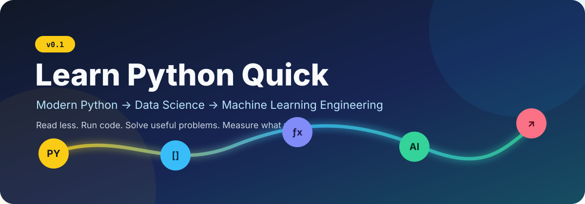

<p align="center">
  
</p>

<p align="center">
  <a href="https://github.com/dmoliveira/learn-python-quick/actions/workflows/ci.yml"></a>
  
  <a href="LICENSE"></a>
  <a href="https://docs.astral.sh/uv/"></a>
  <a href="https://docs.astral.sh/ruff/"></a>
</p>

<h1 align="center">🐍 Learn modern Python by building useful things</h1>

**Learn Python Quick** is a practical review course for software engineers moving into **Data
Science**, **Machine Learning**, or **AI engineering**. It starts with functions and data structures,
then moves through typed design, NumPy, pandas, model evaluation, XGBoost, PyTorch, embeddings,
recommenders, and FastAPI.

The default path is offline-friendly, CPU-small, and tested. Advanced libraries are optional.
Examples are educational building blocks—not production systems.

## ⚡ Five-minute start

You need [Git](https://git-scm.com/) and [uv](https://docs.astral.sh/uv/getting-started/installation/).
`uv` installs the right Python version and dependencies for you.

```bash
git clone https://github.com/dmoliveira/learn-python-quick.git
cd learn-python-quick
uv sync --dev
uv run lpq roadmap
make check
```

`make check` is your **first green command**. Then try an exercise:

```bash
make exercise ID=easy/01_sales_summary
```

That learner check fails at first by design. Open
[`exercises/easy/01_sales_summary/answer.py`](exercises/easy/01_sales_summary/answer.py), implement the
small function, and run it again. The normal repository CI stays green because starter checks and
learner behavior checks are separate.

> **Want PyTorch, XGBoost, and FastAPI too?** Run `uv sync --dev --all-extras`. See the
> [setup guide](docs/setup.md) for smaller extra-by-extra installs.

## 🗺️ Choose a path

| Goal | Suggested route | Time |
|---|---|---:|
| **Fast Python review** | Chapters 01 → 04 → easy exercises | 3–4 h |
| **Data Scientist** | Chapters 01 → 07 → metric and pipeline exercises | 7–9 h |
| **ML Engineer** | Chapters 01 → 12 → hard exercises | 10–14 h |

See the detailed [learning paths](docs/learning-paths.md). You can read in order or jump directly to
one topic—the prerequisites at the top of each chapter show what you need.

## 📚 Curriculum

| # | Module | You will practice |
|---:|---|---|
| 00 | [Start here](chapters/00_start_here/README.md) | Environment, imports, tests, and the learning loop |
| 01 | [Python fundamentals](chapters/01_python_fundamentals/README.md) | Values, functions, arguments, control flow, loops, exceptions |
| 02 | [Data structures and iteration](chapters/02_data_structures_and_iteration/README.md) | Lists, dicts, sets, tuples, comprehensions, `collections`, `itertools` |
| 03 | [Types, OOP, and Pydantic](chapters/03_types_oop_and_pydantic/README.md) | Type hints, classes, protocols, composition, runtime validation |
| 04 | [Files, regex, and HTTP](chapters/04_files_regex_and_http/README.md) | `pathlib`, JSONL/CSV, regular expressions, Requests, safe errors |
| 05 | [NumPy and pandas](chapters/05_numpy_and_pandas/README.md) | Arrays, broadcasting, vectorization, joins, groups, missing data |
| 06 | [ML workflows and metrics](chapters/06_ml_workflows_and_metrics/README.md) | Splits, leakage, pipelines, regression/classification evaluation |
| 07 | [Trees and XGBoost](chapters/07_trees_and_xgboost/README.md) | Decision trees, ensembles, gradient boosting, early stopping |
| 08 | [PyTorch and image models](chapters/08_pytorch_and_images/README.md) | Tensors, autograd, MLP training, 8×8 digit classification |
| 09 | [Embeddings and transformers](chapters/09_embeddings_and_transformers/README.md) | Similarity search, attention, transformer building blocks |
| 10 | [Recommenders](chapters/10_recommenders/README.md) | Popularity, collaborative signals, ranking metrics, neural extension |
| 11 | [FastAPI and MLE](chapters/11_fastapi_and_mle/README.md) | Typed request/response contracts, model serving, API tests |
| 12 | [Performance and quality](chapters/12_performance_and_quality/README.md) | Profiling, vectorization, generators, caching, testing, review |

## 🧩 Exercises that feel like work

Every exercise has prerequisites, an API contract, example input/output, a public test command, and
an explained answer in [`solutions/`](solutions/README.md). Tests are learning feedback, not secret
grading—everything in this public repository is visible.

| Level | Problem | Main skills |
|---|---|---|
| 🟢 Easy | [Summarize café sales](exercises/easy/01_sales_summary/README.md) | Functions, loops, dicts, validation |
| 🟢 Easy | [Triage incident logs](exercises/easy/02_incident_log/README.md) | Regex, parsing, exceptions |
| 🟡 Medium | [Build customer features](exercises/medium/03_customer_features/README.md) | pandas, grouping, data quality |
| 🟡 Medium | [Evaluate a classifier](exercises/medium/04_classification_metrics/README.md) | Metrics, edge cases, interpretation |
| 🔴 Hard | [Train a leakage-safe risk model](exercises/hard/05_risk_pipeline/README.md) | Pipelines, preprocessing, model evaluation |
| 🔴 Hard | [Recommend unseen items](exercises/hard/06_recommender/README.md) | Ranking, deterministic ties, `Precision@K` |

Want more after these six? The [challenge catalog](docs/exercise-guide.md#challenge-catalog) adds
PyTorch, XGBoost, embeddings, image, and API extensions without making the first path heavy.

## 📊 Data and evaluation

- Core examples use small datasets packaged by scikit-learn: Breast Cancer Wisconsin, Diabetes,
  Wine, and Digits. They do not download data at runtime.
- Exercise fixtures are generated in this repository and can be recreated exactly.
- The [dataset manifest](datasets/manifest.json) and [dataset guide](docs/datasets.md) record source,
  terms, generation, and network behavior.
- The [metrics guide](docs/metrics.md) explains what to measure for regression, classification,
  images, retrieval, and recommenders—and what each metric can hide.

## 🧱 Repository map

```text
chapters/    short guides + runnable examples
datasets/    generated fixtures + provenance manifest
docs/        setup, paths, metrics, references, and glossary
exercises/   starter code and learner-facing tests
solutions/   working answers with reasoning
src/         reusable, typed course code
tests/       core, solution, docs, and optional integration checks
```

## ✅ Engineering standards

The repository follows public guidance such as [PEP 8](https://peps.python.org/pep-0008/), the
[Python typing specification](https://typing.python.org/), official library documentation, small
reviewable modules, deterministic tests, and explicit API contracts. These practices are common on
large engineering teams. We do **not** claim to reproduce private Google or Meta standards; public
company guides are listed as additional context in [references](docs/references.md).

Run the same gates used by CI:

```bash
make check         # core, offline-default, target under 60 seconds
make wheel-smoke   # clean wheel install + outside-repo execution
make setup-all && make test-optional  # optional integrations, target under 3 minutes
```

## 🤝 Contributing

Small fixes, new exercises, accessibility improvements, and clearer explanations are welcome. Read
[`CONTRIBUTING.md`](CONTRIBUTING.md) before opening a pull request. This project uses the
[MIT License](LICENSE) and the [Contributor Covenant](CODE_OF_CONDUCT.md).

<p align="center"><strong>Fork it. Break it. Measure it. Improve it. 🚀</strong></p>
